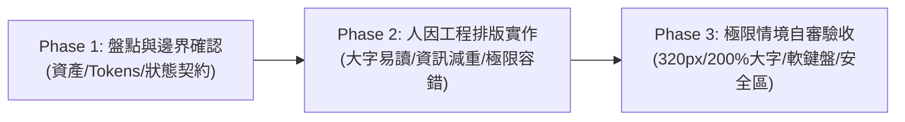

# NewCola UIUX (v2.0 人因工程與生活感介面規範)

> 💡 **版本狀態**：v2.0 (2026-09-21 優化版) ｜ **安全回退備份**：`../newcolauiux_backup_20260921_v1/`

把介面做成可以每天使用的產品：**溫暖但不幼稚、清楚但不冷硬、內容精簡而操作完整**。這是使用者偏好的工作規範與人機工程標準，不是每個專案都要長一樣的模板。

---

## 一、三階段執行工作流程 (The 3-Phase Standard)

### Phase 1: 既有資產與邊界盤點 (Audit & Boundaries)
1. **讀取既有素材**：先讀當前畫面、品牌素材、Design Tokens、共用元件庫與資料流程。
2. **釐清需求邊界**：分清楚「已上線實作」、「已批准修改」、「尚待確認提案」與「失效舊規格」，不把提案誤報為已上線。
3. **品牌風格分流**：
   - **動齡專案或指定延續動齡風格**：讀取 [動齡視覺基準](references/moveage-profile.md)。
   - **其他品牌／新專案**：沿用該品牌原有用色與識別，僅移植「大字閱讀、關聯留白、卡片減重與真實操作」核心原則，**絕不硬套動齡青綠配色**。
4. **授權與跨平台**：
   - 使用者已給定具體修改方向時直接執行，只有缺漏資訊真正影響結果才提問。
   - 本技能不授權自動發布正式站、改動後端 API 契約或變更法律免責條款。
   - 交付其他 AI 時提供 [可攜式提示詞](references/portable-prompt.md)。

---

### Phase 2: 人因工程排版與實作標準 (Implementation Standards)

#### 1. 延續品牌，杜絕制式 AI 模板感 (Anti-AI Slop)
- **保留正式識別**：保留正式 LOGO 原檔、比例與配色，沿用已確認文案與登入機制。不因參考圖好看就擅自複製其中的產品名、認證標章或功能承諾。
- **純粹質感**：以真實內容、穩定對齊、恰當留白建立質感。除非品牌明確需要，**預設禁用**：
  - ❌ 紫藍霓虹漸層、高斯模糊玻璃擬態 (Glassmorphism)、發光霓虹邊框。
  - ❌ 滿版漂浮裝飾球、每一小段塞一張巨大浮空卡片。
  - ❌ 無實質引導用途的裝飾性 Emoji/圖示堆疊、行銷口號式的假大空 Hero 區塊。

#### 2. 大字易讀 ＆ 資訊精簡減重 (Anti-Bloat Typography)
- **清晰字級階梯 (rem 基準)**：
  - **正文／輸入框／操作按鈕**：`1.125rem`（預設 18px，行高 1.5–1.6）。
  - **欄位標籤／次要輔助說明**：`1rem`（預設 16px，行高 1.5–1.6）。
  - **區塊標題／彈窗標題**：`1.5rem`（預設 24px，行高約 1.35）。
  - **頁面主要大標題**：`1.75rem`（預設 28px，行高約 1.3）。
  - **重要量測數值**：`28px–36px`（數值與單位強綁定，禁止拆行拆散）。
  - *字重與大小需有層級，禁止全頁文字皆加粗或全體放大。*
- **卡片減重四步法 (由先至後)**：
  1. 刪除重複的鼓勵或廢話說明 ➔
  2. 合併同質相關數據（如將收縮壓、舒張壓、脈搏整合為緊湊資料卡） ➔
  3. 將教學、歷史紀錄或次要備註移入可展開抽屜或彈窗 ➔
  4. 收緊多餘卡片 Padding 與巢狀邊框。
  - *禁止以「縮小字體」或「縮小點擊區」作為縮減版面的手段。*

#### 3. 關聯留白與觸控熱區 (Spacing & Thumb Zone)
- **留白階梯**：嚴格遵循 `4 / 8 / 12 / 16 / 20 / 24 / 32px` 比例。相關資訊靠近（8–12px），不同區塊再拉開（20–24px），禁止整頁機械式平均撒空白。
- **拇指熱區與觸控防呆**：
  - 一般點擊目標最小 `48×48px`，主要行動按鈕（CTA）最小高度 `56px`（`min-h-[56px]`），高度允許隨大字換行自然成長。
  - 手機兩側邊距標準為 `16–24px`。
  - 表單輸入框與下方說明卡至少間隔 `24px`，焦點外框（Focus Ring）禁止被父容器 `overflow: hidden` 切邊。

#### 4. 一屏完成為目標，極限容錯為底線 (Extreme Fault-Tolerance)
- **視窗核心化**：優先將核心輸入、目前狀態與下一步主按鈕納入同一視窗。
- **禁止硬塞**：在小手機 (320px/375px)、200% 系統大字模式、橫向螢幕或軟鍵盤彈出時，**必須允許頁面正常平滑滾動**。
- **四不原則**：
  - ❌ 禁止禁用瀏覽器縮放。
  - ❌ 禁止硬縮字體以塞入一屏。
  - ❌ 禁止用 `overflow: hidden` 藏匿超出內容。
  - ❌ 禁止讓固定底部按鈕遮擋輸入欄位。

#### 5. 圖片、裝飾與節慶服務於內容
- **圖片比例**：需要人物或商品完整呈現時使用 `object-contain` 或保留原始長寬比，文字分開獨立排版，禁止文字直接壓在臉部或產品細節上；頭像使用圓形 `object-cover`，padding 為 0。
- **節慶主題**：節慶僅變更視覺裝飾層，品牌 LOGO 與核心操作維持不變；必須具備明確生效日期、時區、結束自動回退機制與手動切換除錯介面。

#### 6. 講白話，數值具備明確語義 (Data Integrity & Human Tone)
- **繁體中文（台灣在地化）**：稱謂統一使用「您」。使用直接動詞（如「儲存紀錄」、「重新整理」、「一般帳號登入」），避免生硬工程詞彙。
- **數據完整性**：每個數值必須具備明確名稱、單位與時間戳記；狀態以「顏色 + 文字標籤」雙重標記（禁止僅單獨放置無文字之彩色圓點）。未知不等於 0，空清單不等於載入失敗；錯誤狀態必須提供明確下一步重試指引並保留已輸入內容。

#### 7. 完整狀態矩陣才算完成 (Full State Matrix)
- 每個互動模組必須完整處理 6 大狀態：`Loading`（載入骨架）、`Empty`（引導操作之空狀態）、`Error`（可重試且保留輸入之錯誤）、`Success`（明確即時反饋）、`Disabled`（清晰禁用原因）、`Unsaved`（未儲存離開確認）。
- 彈窗規範：必須包含清楚標題、獨立關閉按鈕、焦點限制（Focus Trap）、背景點擊阻擋與內容獨立滾動區。

---

### Phase 3: 極限情境自審與驗收 (Verification & Delivery)

在交付實作程式碼前，必須逐項通過以下自審清單：

| 檢核維度 | 檢核標準 | 通過確認 |
| :--- | :--- | :---: |
| **視覺減重** | 拿掉所有非必要裝飾後，資訊順序與主要操作是否依然清楚突出？ | [ ] |
| **大字易讀** | 在 150% 與 200% 系統字級下，所有按鈕是否依然可點擊、文字無重疊破版？ | [ ] |
| **觸控尺寸** | 所有可點擊元件是否符合 48px / 56px 最小觸控熱區規範？ | [ ] |
| **極限視窗** | 在 320px/375px 寬度及軟鍵盤彈出時，主要按鈕與輸入欄位是否無遮擋且可滾動？ | [ ] |
| **安全邊界** | 頂部與底部是否皆正確適應 `env(safe-area-inset-top/bottom)`？ | [ ] |
| **狀態完整** | 載入中、無資料、網路失敗、重複提交防護是否皆具備真實可用介面？ | [ ] |
| **品牌保真** | 是否完整保留原 LOGO 與核心功能？是否無冒用未經授權的認證或功能？ | [ ] |

---

## 二、交付輸出規範

交付修改時，應具備結構化報告：
1. **修改摘要 (What & Why)**：簡述調整內容及其人因工程/易讀性理由。
2. **實作程式碼或可操作成果**：提供完整、乾淨、附註解之程式碼。
3. **驗證矩陣**：列出已驗證之螢幕尺寸（如 320px / 375px / 430px）、字級模式與狀態分支。
4. **待確認邊界**：清楚標記哪些為既有上線功能，哪些為本次新建提案。
